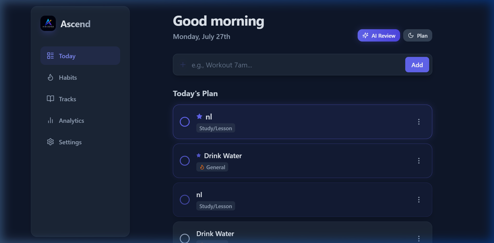
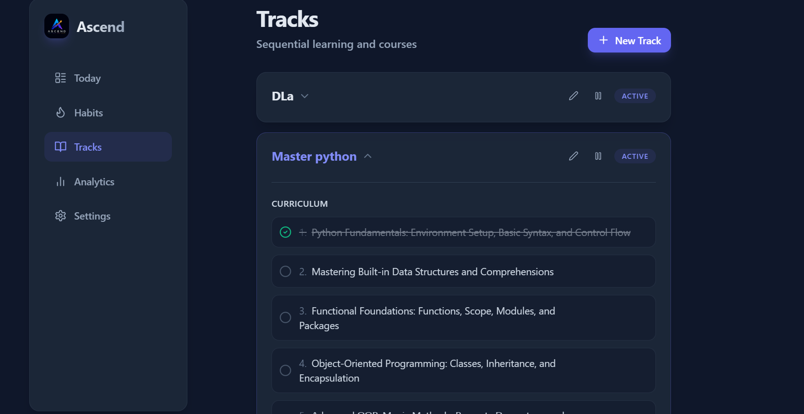
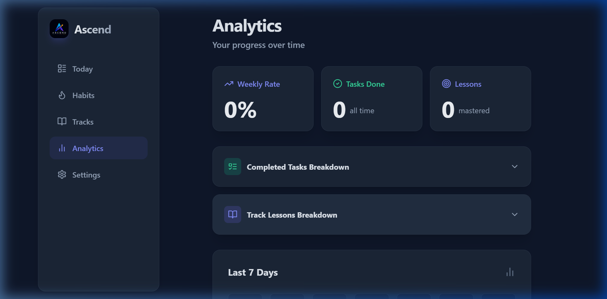

# 🚀 ASCEND: AI-Powered Personal Growth Companion

### 🌐 [Live Demo: Experience Ascend Here](https://ascendapp-rho.vercel.app/)

## 📖 What is Ascend?
**App Name:** ASCEND

**What it does:** Ascend is a privacy-first, fully local Progressive Web App (PWA) designed to act as your ultimate personal growth companion. It helps you plan daily goals, track habits, learn new skills through AI-generated tracks, and reflect on your progress with a personalized AI nightly summary. 

**The Problem it Solves:** Traditional "Life OS" dashboards often become overwhelming backlogs of uncompleted tasks, which leads to burnout and guilt. Ascend solves this friction by focusing exclusively on a single day at a time. Missing a day doesn't wipe your history or punish you; instead, the system gracefully scales down expectations to keep you moving forward.

**Who it's for:** Students, self-learners, and professionals who want to build consistent habits and master new skills without the anxiety of a massive, cluttered to-do list.

---

## ✨ Features List
*   🎯 **The "Today" Screen:** A single, focused view of your day. See your habits, one-off tasks, and exactly one lesson from your active learning tracks. No overwhelming backlogs.
*   🧠 **AI Curriculum Generator:** Type any skill you want to master (e.g., "Fullstack React Developer"), and the AI instantly generates a perfectly paced 8-15 step learning syllabus.
*   🤖 **AI Nightly Review:** A personalized, end-of-day summary that praises your consistency, gently reframes missed tasks, and provides actionable advice for tomorrow.
*   🔔 **Smart Notifications & Reminders:** Get local, offline-capable push notifications reminding you of scheduled tasks, habits, and your nightly planning ritual.
*   🌙 **Nightly Planning Ritual:** A focused flow to plan your next day, utilizing a smart default timing engine if you don't specify explicit times.
*   📈 **Habit Streaks & Analytics:** Visual streak counters, a GitHub-style consistency heatmap, and a custom interactive donut chart tracking your all-time mastery.
*   📱 **Installable PWA:** Install it directly to your desktop or mobile home screen as a native-feeling app (offline-capable).
*   🔒 **100% Local-First & Private:** Your tasks, habits, and journal entries never leave your device. All data is stored locally in IndexedDB. AI requests use your own API key (Bring-Your-Own-Key).

---

## 🧠 The AI Feature Inside Ascend
Ascend utilizes the powerful **Gemini 3.6 Flash** model to provide two core capabilities:
1. **Curriculum Generation:** Creates an actionable syllabus for any new skill you want to learn.
2. **Nightly Review:** Acts as a compassionate productivity coach.

**How it works (The System Prompt):**
When you trigger the Daily Review, the app securely passes your day's completion stats to Gemini using this exact system instruction:
> *"You are Ascend, a highly encouraging, premium, and concise AI productivity companion. The user is ending their day. Here is their data for today... Please write a short, inspiring bedtime summary. 1. Praise them for what they completed. 2. Provide a gentle, non-judgmental perspective on what they missed. 3. Give them one small piece of actionable advice or an encouraging thought for tomorrow. Keep it under 4 short paragraphs. Use a warm, professional, and slightly futuristic tone."*

---

## 🛠️ Tools, Services, and AI Models
*   **Frontend Framework:** React 19 + TypeScript + Vite
*   **Styling:** Tailwind CSS (Custom utility classes, glassmorphism, micro-animations)
*   **Database:** Dexie.js (IndexedDB wrapper for local-first storage)
*   **Icons:** Lucide React
*   **AI Engine:** Google Gemini API (`gemini-3.6-flash`) via direct REST
*   **PWA / Service Workers:** `vite-plugin-pwa`
*   **Deployment Hosting:** Vercel

---

## 📸 Screenshots

### The "Today" Screen


### AI Curriculum Generator (Tracks)


### Analytics & Streaks Dashboard


---

## 🚀 How to Run the Project Locally

1. **Clone the repository:**
   ```bash
   git clone https://github.com/Muhammadfaheem8988/ASCEND.git
   cd ASCEND
   ```
2. **Install dependencies:**
   ```bash
   npm install
   ```
3. **Run the development server:**
   ```bash
   npm run dev
   ```
4. **Configure your AI Key:**
   * Open the app in your browser at `http://localhost:5173`.
   * Navigate to the **Settings** tab.
   * Paste your Gemini API key (from Google AI Studio) into the designated field. (Your key remains 100% local on your device).
